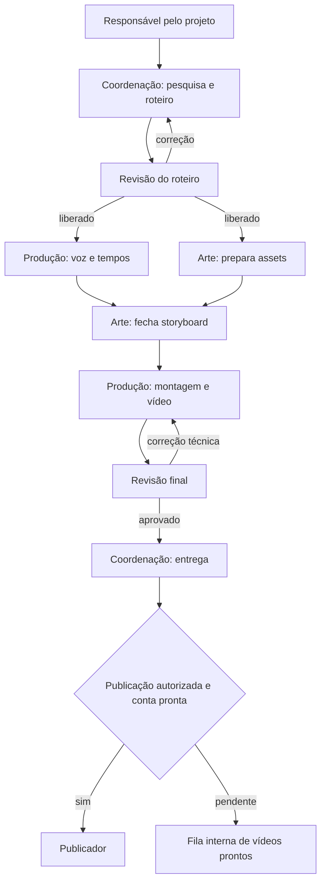

# Fluxo de produção do estúdio

Os IDs reais dos quatro agentes ficam em `AGENTES.json`. Todos consultam o estado do projeto antes de produzir. A configuração e a bíblia guardam as decisões; o banco controla etapas e versões; os arquivos do episódio guardam o conteúdo e as evidências.

## Etapas e entregas

| Etapa | Responsável | Entrada | Saída |
| --- | --- | --- | --- |
| Setup | Coordenação com o responsável | Respostas e ferramentas disponíveis | Bíblia, configuração, fontes testadas e piloto definido |
| Pesquisa e roteiro | Coordenação | Tema, fontes e oferta comprovada | Ficha e roteiro versionado |
| Revisão do roteiro | Revisão | Roteiro e ficha | Parecer da versão |
| Voz | Produção | Roteiro liberado | Falas conferidas e tempos reais |
| Preparação de arte | Arte | Roteiro liberado | Assets mínimos; pode ocorrer durante a voz |
| Storyboard final | Arte | Assets e tempos da voz | Storyboard sincronizado |
| Montagem e exportação | Produção | Roteiro, áudio e storyboard compatíveis | MP4, folha de quadros e produção |
| Revisão final | Revisão | Corte atual e evidências | Parecer da versão |
| Entrega | Coordenação | Corte aprovado | Cópia em videos-prontos e pacote |
| Publicação opcional | Publicador autorizado | Pacote, conta e autorização | Recibo de agendamento ou publicação |



## Arquivos por episódio

```text
episodios/<AAAA-MM-DD>-<slug>/
  roteiro.md
  status.md
  revisao-roteiro.md
  storyboard.md
  storyboard/storyboard.json
  storyboard/quadros/
  arte/
  audio/falas/
  audio/tempos.json
  audio/tempos.md
  montagem.json
  final/vN.mp4
  contact.jpg
  producao.md
  revisao-final.md
```

## Estados e versões

`pauta → pesquisa → roteiro → revisao_roteiro → producao → revisao_final → aprovado → pronto → publicado`.

Um ajuste exato usa `ajuste_roteiro`. Faltas que impedem prosseguir usam `bloqueado`; um veto usa `vetado`. A pausa do projeto interrompe toda a esteira sem apagar a etapa de cada episódio. Durante `producao`, arte e voz têm estados próprios para permitir preparação em paralelo.

O SQL vincula o parecer ao número de versão. Mudança material de roteiro invalida voz, arte e parecer final; correção visual invalida o corte. Um ajuste exato prescrito pela Revisão pode produzir a versão seguinte do roteiro sem nova rodada, desde que a Coordenação registre a troca e não introduza informação nova.

## Responsabilidade e comunicação

A Coordenação edita configuração editorial, roteiro, status de coordenação, entrega e pacote. A Arte edita arte e storyboard. A Produção edita estúdio, áudio, montagem e vídeo. A Revisão edita pareceres e o checklist aprovado. Cada um atualiza os campos de controle correspondentes ao seu trabalho.

Uma mensagem por entrega, com episódio, versão, arquivos e ação. Achados e progresso sem ação ficam no arquivo ou controle apropriado. Alterações materiais devem identificar os destinatários afetados. Se a ferramenta de mensagens não existir, use o mecanismo de encaminhamento configurado no setup e registre a pendência.

## Revisão e custo

O roteiro tem uma revisão ordinária. O vídeo tem até duas rodadas ordinárias e, depois, escalonamento dos bloqueios restantes. O número de rodadas não elimina exigência factual ou defeito bloqueante. Uma observação menor não obriga nova produção.

Registre cada operação paga uma vez e atualize a medição no mesmo registro. Consulte orçamento antes de gerar mídia. A Coordenação serializa a autorização de gastos do mesmo episódio, ou usa reservas do provedor, para que arte e voz não consumam o mesmo saldo ao mesmo tempo.

## Rotina e publicação

Rotina, aprovação do piloto e autorização de publicação são decisões distintas, registradas no setup. Um piloto aprovado não ativa automaticamente a fábrica nem concede acesso à conta social. O publicador só recebe o pacote dentro do escopo autorizado; a confirmação real de envio ou publicação precisa de recibo.

As queries de publicação acompanham cada conta e rede separadamente. A etapa geral `publicado` indica pelo menos um destino confirmado; os demais destinos continuam sendo acompanhados em `studio_publicacoes`.
